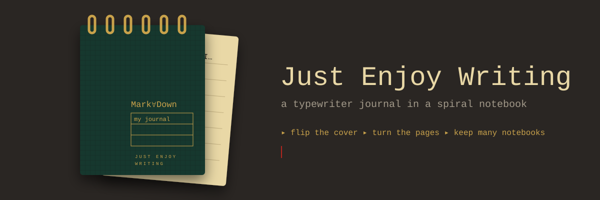

<p align="center"></p>

<p align="center">
  
  
  
  
</p>

> *Pick a notebook off the shelf. Flip it open. Type like it's 1950.*

A small journaling web app styled after a pocket spiral notebook: a gold-ringed green cover that swings open, lined paper, and a typewriter font. No accounts, no server, no build step.

## ✦ Features

| | |
|---|---|
| 📓 **Real notebook feel** | The cover flips up on its spiral binding, and every page turn is a 3D flip |
| ⌨️ **Typewriter writing** | Special Elite font, ink-black text, red caret, ruled lines |
| 📚 **A shelf of notebooks** | Make as many as you like, each with its own cover colour and its own pages |
| 🏷️ **Label your cover** | Three editable rows on each cover: name, subject, date / notes |
| 🖱️ **Gestures** | Scroll or swipe: down opens and turns pages, up turns back, closes, then returns to the shelf |
| 🗑️ **Delete** | Remove a notebook from the shelf (with a confirmation) |
| 📱 **Installable** | Works as an app on desktop and phone, and offline after the first visit |

## ✦ How to use

```
shelf ──click──▶ closed notebook ──click / scroll ↓──▶ open page
                       ▲                                  │
                       └────── scroll ↑ on page 1 ◀───────┘
```

- **Open / close:** click the cover (or scroll down) · "close ✕" (or scroll up on page 1)
- **Pages:** `‹` `›` · "+ new page" · scroll or swipe
- **Name a notebook:** click the rows on the cover and type
- **New notebook:** type a name, choose a colour, press "+ add" on the shelf

## ✦ Run it

No install needed. Serve the folder and open it:

```bash
python3 -m http.server 8000
# then visit http://localhost:8000
```

Opening `index.html` directly works too, but installing it as an app needs http(s).

### Install as an app
- **Desktop Chrome:** click the install icon in the address bar
- **iPhone:** Safari → Share → Add to Home Screen
- **Android:** Chrome → Install app

## ✦ Your data

Everything is stored in your browser's `localStorage`: nothing is uploaded. That also means each browser or device keeps its own notebooks, and clearing site data erases them.

## ✦ Files

```
index.html            the whole app (HTML + CSS + JS)
manifest.webmanifest  app name and icons
sw.js                 offline cache
icon*.png / icon.svg  app icons
banner.svg            the image at the top of this page
```

<p align="center"><sub>🖋️ just enjoy writing</sub></p>
